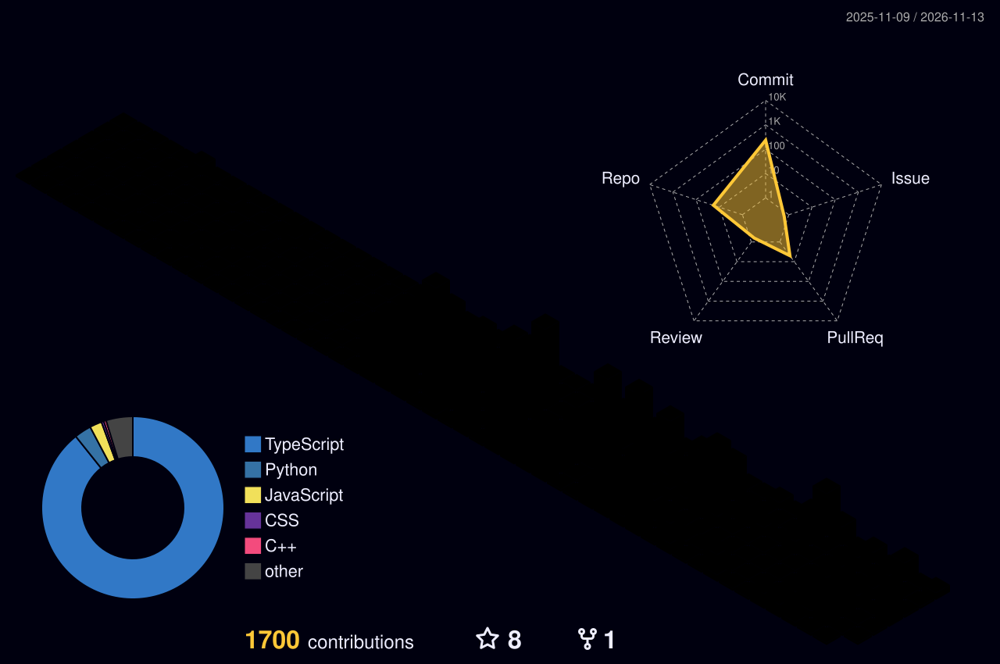

  

  

<h2 align="center">⟡ &nbsp; About &nbsp; ⟡</h2>

<table align="center" width="100%">
<tr>
<td width="100%">

Computer Engineering student at **Universitas Syiah Kuala**, based in Banda Aceh, Indonesia. Founder of **PT Arina Digital Mandiri**, working across software engineering, AI, cybersecurity, cloud infrastructure, embedded systems, and IoT.

My work focuses on designing scalable digital platforms, integrating intelligent systems, and developing practical engineering solutions.

*"DO-DOIT"*

**Currently engaged in**

&nbsp;&nbsp;◆ Full-stack software engineering and DevOps tooling

&nbsp;&nbsp;◆ Artificial intelligence and data engineering

&nbsp;&nbsp;◆ Offensive and defensive cybersecurity

&nbsp;&nbsp;◆ Embedded systems and IoT development

&nbsp;&nbsp;◆ Cloud infrastructure and automation

</td>
</tr>
</table>

<h2 align="center">⟡ &nbsp; Achievements & Competitions &nbsp; ⟡</h2>

<table align="center">
<tr>
<th align="center">Achievement</th>
<th align="center">Recognition</th>
</tr>
<tr>
<td align="center"><b>Huawei Cloud Challenge 2026</b></td>
<td align="center">Selected University Representative</td>
</tr>
<tr>
<td align="center"><b>HackNusa 2026</b></td>
<td align="center">National Finalist & Team Leader</td>
</tr>
<tr>
<td align="center"><b>APIE Virtual Camp</b></td>
<td align="center">International Program Participant</td>
</tr>
</table>

 

### Huawei Cloud Challenge 2026

**Huawei Cloud Challenge Day | Cloud Track**

Successfully passed the qualification assessment and was selected to represent **Universitas Syiah Kuala (USK)**, particularly its **Computer Engineering program**, in the competition.

**Focus:** Cloud Computing · Cloud Infrastructure · Technical Problem Solving

### HackNusa 2026

**Kaspersky x Telkom University**

Served as **Team Leader and National Finalist**, advancing to the in-person final round in Bandung, Indonesia.

**Focus:** Cybersecurity · Team Leadership · Technical Competition

### APIE Virtual Camp

**SOI Asia / APIE**

Participated in an international educational initiative focused on technology, digital learning, and cross-border collaboration.

**Focus:** International Collaboration · Technology · Digital Learning

<h2 align="center">⟡ &nbsp; Certifications & Professional Development &nbsp; ⟡</h2>

<table align="center">
<tr>
<th align="center">Certification / Program</th>
<th align="center">Organization</th>
<th align="center">Year</th>
</tr>
<tr>
<td align="center"><b>AWS Academy Graduate, Cloud Developing</b></td>
<td align="center">AWS Academy</td>
<td align="center">2026</td>
</tr>
<tr>
<td align="center"><b>APIE e-Workshop</b></td>
<td align="center">SOI Asia / APIE</td>
<td align="center">2026</td>
</tr>
<tr>
<td align="center"><b>APIE Virtual Camp</b></td>
<td align="center">SOI Asia / APIE</td>
<td align="center">2026</td>
</tr>
<tr>
<td align="center"><b>Understanding the Internet</b></td>
<td align="center">Keio University / FutureLearn</td>
<td align="center">2025</td>
</tr>
<tr>
<td align="center"><b>Hour of Code, CodeAI</b></td>
<td align="center">Code.org</td>
<td align="center">2024</td>
</tr>
<tr>
<td align="center"><b>Bebras USK, Committee</b></td>
<td align="center">Universitas Syiah Kuala</td>
<td align="center">2026</td>
</tr>
</table>

<h2 align="center">⟡ &nbsp; Featured Engineering Projects &nbsp; ⟡</h2>

<table align="center">
<tr>
<th align="center">Project</th>
<th align="center">Engineering Focus</th>
<th align="center">Link</th>
</tr>
<tr>
<td align="center"><b>Firish.OS</b></td>
<td align="center">Full-Stack · SaaS · POS</td>
<td align="center"><a href="https://firishos.my.id/">Website</a></td>
</tr>
<tr>
<td align="center"><b>AgreBrief</b></td>
<td align="center">B2B Contracts · Web Engineering</td>
<td align="center"><a href="https://agrebrief.my.id/">Website</a></td>
</tr>
<tr>
<td align="center"><b>AEEGIS SYSTEM</b></td>
<td align="center">Cybersecurity · Web Security</td>
<td align="center"><a href="https://aeegis.aryiion.my.id/">Website</a></td>
</tr>
<tr>
<td align="center"><b>Arina DevOps Hub</b></td>
<td align="center">GitHub Apps · CI/CD · DevOps</td>
<td align="center"><a href="https://github.com/PT-ARINA-DIGITAL-MANDIRI/arina-devops-hub">Repository</a></td>
</tr>
<tr>
<td align="center"><b>NEX-GAS</b></td>
<td align="center">Renewable Energy · Prototype</td>
<td align="center">Research Project</td>
</tr>
<tr>
<td align="center"><b>IoT Foot Ulcer Detection</b></td>
<td align="center">IoT · Sensors · Healthcare</td>
<td align="center">Engineering Project</td>
</tr>
</table>

 

### Firish.OS | Restaurant Operating System

A restaurant management platform designed to streamline point-of-sale operations, inventory management, employee attendance, shifts, and multi-outlet business workflows.

### AgreBrief | B2B Contract Platform

A digital platform focused on simplifying business contract creation and document workflows.

### AEEGIS SYSTEM | Cybersecurity Platform

A cybersecurity-oriented platform focused on web security and digital protection.

### Arina DevOps Hub | GitHub Integration Platform

An internal DevOps platform project for monitoring repository activity, GitHub Actions workflows, pull requests, and software delivery operations.

*Development in progress.*

### NEX-GAS | Biogas Prototype

An engineering prototype exploring biogas technology and sustainable energy applications.

### IoT Foot Ulcer Detection System

An IoT-based engineering project exploring sensor-assisted detection of potential foot ulcers and connected healthcare monitoring.

<h2 align="center">⟡ &nbsp; PT Arina Digital Mandiri &nbsp; ⟡</h2>

<table align="center">
<tr>
<th align="center">Business Unit</th>
<th align="center">Primary Focus</th>
</tr>
<tr>
<td align="center"><a href="https://kvfldigital.arinadigitalmandiri.my.id/"><b>KVFL Digital</b></a></td>
<td align="center">IT Consulting & Web Development</td>
</tr>
<tr>
<td align="center"><a href="https://firishos.my.id/"><b>Firish.OS</b></a></td>
<td align="center">Restaurant Management SaaS</td>
</tr>
<tr>
<td align="center"><a href="https://agrebrief.my.id/"><b>AgreBrief</b></a></td>
<td align="center">B2B Contract Automation</td>
</tr>
<tr>
<td align="center"><a href="https://aeegis.aryiion.my.id/"><b>AEEGIS SYSTEM</b></a></td>
<td align="center">Web Security & Cybersecurity</td>
</tr>
</table>

 

**[Visit PT Arina Digital Mandiri](https://arinadigitalmandiri.my.id/)**

<h2 align="center">⟡ &nbsp; Technical Stack &nbsp; ⟡</h2>

  

**AI / Data Labeling**

  

<h2 align="center">⟡ &nbsp; GitHub Activity &nbsp; ⟡</h2>

  

<h2 align="center">⟡ &nbsp; Connect &nbsp; ⟡</h2>

<b>BANDA ACEH, INDONESIA</b> &nbsp;·&nbsp; PT ARINA DIGITAL MANDIRI &nbsp;·&nbsp; © 2026

